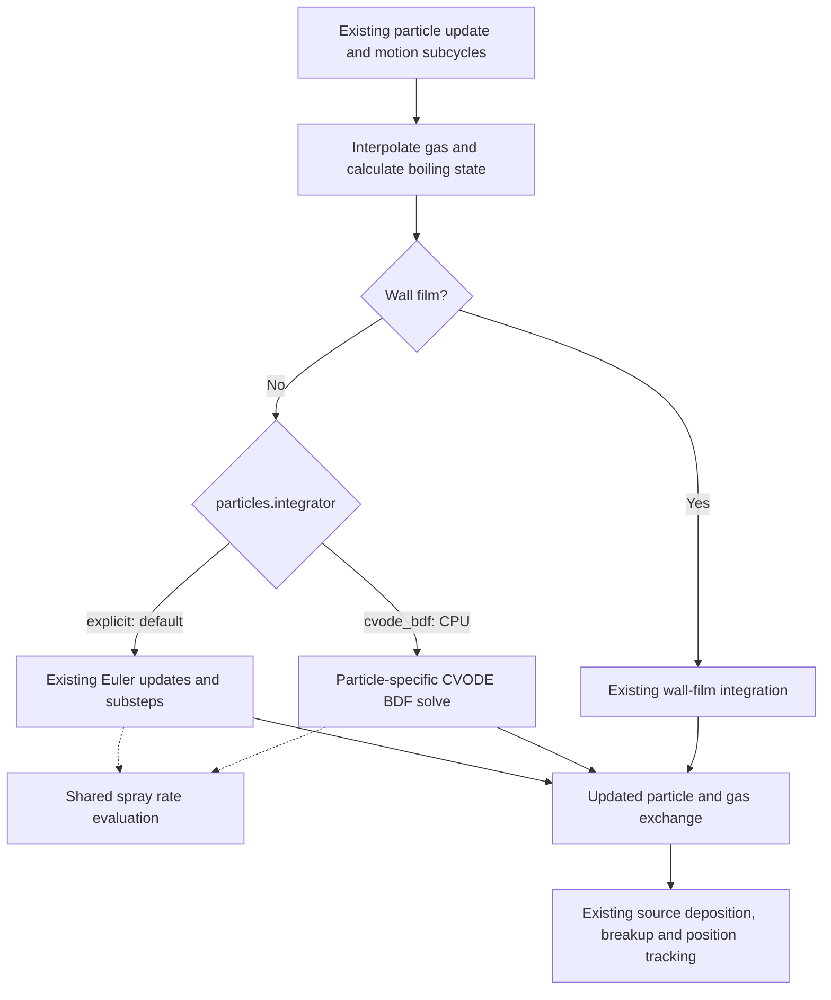

# CVODE BDF integration for spray particles

**Implementation report — 11 November 2026**

## Summary and scope

An optional CPU CVODE BDF integrator has been added to the PelePhysics dependency
and was validated through a downstream PeleLMeX checkout. It advances droplet velocity, temperature, and
liquid-component masses together, with integrated momentum and energy exchange.
The existing particle container, mesh interpolation/deposition, checkpoint format,
and application coupling are retained. The production default remains the native
explicit method.

The purpose is to handle stiff droplet ODEs, particularly the short relaxation
times of small droplets. Validation demonstrates stable integration in a Stokes
case where the explicit implementation produces NaN. It also shows that CVODE
has substantial overhead for a large population of mildly stiff droplets.

The revised exchange error scales and default maximum BDF order of 2 reduce
advance time by **20–21 times** relative to the initial implicit configuration.
The revised default remains **13–16 times slower than explicit** in the measured
first-step workload. At roughly comparable error, a loose-tolerance BDF1 trial
remains **6.68 times slower in advancement**, or **1.86 times slower in total
elapsed time**, than explicit Euler. These ratios describe the tested CPU case,
not a general comparison of implicit and explicit methods.

This report consolidates the implementation and retained validation evidence.
The measurement artifacts described below were stored locally, not committed.
The standalone library transfer preserves the validated spray source files;
its base is `8cd738ced025b8979fabca2d7fdd4b58ecd52704`, whose intervening
changes do not modify the spray sources. No new downstream application runs
were performed solely for that transfer.

## 1. Architecture

### Integration into the existing particle update

The implementation uses the existing SUNDIALS dependency directly through a
particle-specific adapter. It does not reuse the chemical reactor's state layout
or alter chemistry integration settings. There is no general particle-integrator
factory or particle-container redesign in this first extension.



The rate evaluator is shared; it computes rates without advancing particles or
writing mesh sources. The explicit path retains its original substep behavior.
The implicit RHS creates a fresh rate-output object for each evaluation.

| Component | Responsibility |
|---|---|
| [SpraySetup.cpp](../Source/Spray/SpraySetup.cpp) | Read the runtime method and solver options during spray setup. |
| [SprayParticles.cpp](../Source/Spray/SprayParticles.cpp) | Create worker workspaces and dispatch each free-droplet subcycle to the selected integrator; preserve the surrounding particle workflow. |
| [SprayRates.H](../Source/Spray/SprayRates.H) | Shared drag, heat-transfer, evaporation, and liquid-component rate calculations. |
| [Drag.H](../Source/Spray/Drag.H) | Native explicit Euler integration, physical-timescale substepping, and original source accounting. |
| [SprayCvode.H/.cpp](../Source/Spray/SprayCvode.cpp) | Concrete CPU solver workspace, RHS, error scales, constraints, depletion events, and accepted-result commit. |
| [Make.package](../Source/Spray/Make.package), [PeleLMeX CMake list](https://github.com/Pele-Suite/PeleLMeX/blob/dd28cee3e8c2c81ce9720e003655bb114b53624c/CMake/BuildPelePhysicsLib.cmake) | Register the GNU make sources and identify the downstream CMake integration point; CMake consumers must add the new source files. |

### Solver state and lifecycle

The ODE state contains:

1. Droplet velocity components, `u`.
2. Droplet temperature, `T`.
3. Individual liquid-component masses, `m_i`.
4. Accumulated interphase momentum exchange, `J`.
5. Accumulated interphase energy exchange, `Q`.

For dimension `D` and `F` liquid components, there are `2D + F + 2` equations:
**7 equations** for the 2D single-component SprayTest and **73** for a 2D
67-component liquid. Composition and diameter are reconstructed from component
masses, temperature, and the liquid-density model. Position is not a CVODE state.

Each CPU worker owns a serial SUNDIALS vector, dense matrix, dense linear solver,
CVODE memory, and SUNDIALS context. One workspace is allocated per worker per
particle-loop invocation and reused across its particles. It is released through
the workspace destructor. This avoids allocating a complete solver per particle.

Each particle stage calls `CVodeReInit`. Memory is reused, but step-size and
multistep history are reset. History cannot be shared between different particles.
The solver uses BDF with Newton iteration and a finite-difference dense Jacobian.
There is no batched particle solve, analytical Jacobian, or matrix-free backend.

MPI distributes particle boxes among ranks; CPU workers advance their particles
independently. The solver does not form a globally coupled particle/gas ODE system.

### Coupling and source accounting

The gas state and boiling temperatures are held fixed within each particle stage,
as in the explicit path. Existing motion-CFL subcycling still applies. Breakup
and position tracking remain outside the implicit ODE solve.

Gas species sources are calculated from accepted component-mass changes.
Momentum and energy exchange are integrated alongside the particle state.
External body force is excluded from interphase momentum feedback. Parcel
multiplicity and the existing deposition sign, weights, and mesh mapping are
retained. Exchange is divided by the **full requested stage interval**, including
when a droplet disappears before the end of that interval.

The existing energy conventions are preserved: PeleLMeX and PeleC have different
energy terms, while manifold EOS retains its zero gas-energy-source convention.
The PeleC branch exists in the source but has not been validated in this work.

CVODE constrains accepted component masses to be nonnegative and temperature to
be positive. Newton trial states use a nonnegative composition extension for rate
evaluation. Component-depletion and minimum-particle-mass roots trigger residual
mass/momentum/enthalpy transfer and solver restart. Tolerance-sized negative root
interpolation errors are corrected with matching exchange adjustments. This
retains the existing residual-vaporization policy; it is not a new phase-equilibrium
or boiling model.

Results are committed after successful integration. A failure reports the
particle and CVODE status and aborts; there is no silent explicit fallback.
Checkpoints retain the original particle fields without serializing CVODE history.

## 2. Runtime controls and accuracy policy

```ini
particles.integrator = cvode_bdf
particles.cvode.rtol = 1.e-6
particles.cvode.max_order = 2
```

Omitting `particles.integrator` selects `explicit`. Chemistry's `ode.*` and
`cvode.*` parameters are independent of `particles.cvode.*`.

| Parameter | Current default, in PeleLMeX MKS units | Meaning |
|---|---:|---|
| `rtol` | `1e-6` | Relative local-error tolerance. |
| `atol_temperature` | `1e-4 K` | Absolute droplet-temperature tolerance. |
| `atol_velocity` | `1e-7 m/s` | Absolute droplet-velocity tolerance. |
| `atol_mass` | `1e-21 kg` | Absolute tolerance for each liquid-component mass. |
| `max_order` | `2` | Maximum BDF order; accepted range 1–5. Order 1 is backward Euler. |
| `max_steps` | `10000` | Internal-step budget per requested particle advance, including depletion restarts. |

Absolute tolerances use the application's native units. The values above are
the MKS defaults; copying them numerically into another unit system is not valid.

The initial implementation controlled zero-start exchange accumulators with
overly restrictive absolute scales. The current momentum scale propagates
physical velocity and mass error budgets:

```text
dm        = F * atol_mass + rtol * initial_mass
u_ref[j]  = max(abs(initial_particle_velocity[j]), abs(gas_velocity[j]))
du[j]     = atol_velocity + rtol * u_ref[j]
atol_J[j] = initial_mass * du[j] + dm * u_ref[j]
```

Energy uses the analogous liquid heat-capacity/temperature scale and a mass-error
contribution based on sensible energy or vapor enthalpy. The PeleC branch also
includes kinetic-energy uncertainty. Exchange variables remain in the error
test, and particle-state tolerances are unchanged.

The native explicit method has no corresponding absolute/relative error test.
It selects substeps from initial drag, evaporation, and thermal timescales, capped
at 100, then applies Euler updates. Consequently, using identical flow timesteps
does not imply equal numerical accuracy. CVODE's tolerances control local weighted
error; they do not guarantee that every final state or gas-field relative error
equals `rtol`.

## 3. Support and limitations

| Area | Current status and consequence |
|---|---|
| CPU | Implemented with serial SUNDIALS vectors and host callbacks. Validated in 2D double precision with GNU make, LLVM, SUNDIALS 7.2.0, and two MPI ranks on macOS arm64. |
| GPU: CUDA/HIP/SYCL | The new implicit path is unsupported. Selecting `cvode_bdf` in a GPU build aborts during initialization. GPU execution of the existing explicit path was not validated in this work. |
| GPU extension | Requires a device-capable orchestration/batching strategy and compatible callbacks/linear algebra. Replacing the serial vector alone would not make the current per-particle host solve a GPU implementation. |
| MPI scaling | Independent rank-local solves are supported. Tests use two ranks; no broad rank-count scaling study was performed. One particle box per level limits rank utilization in the 64-box case. |
| OpenMP | Worker-local workspaces are implemented. An inherited layout-dependence was reproduced in original and changed explicit code. A subsequent investigation confirmed a premature timestep-reduction finalization race; an isolated correction passes explicit 2-/4-thread and current CVODE 2-thread tests. The working-tree routine is not yet patched. See [OPENMP_DIAGNOSIS.md](../Testing/SprayCvode/OPENMP_DIAGNOSIS.md). |
| Particle population and liquid-component count | Dense workspaces and Jacobians grow with the ODE size. Per-particle cold starts, Newton iterations, and repeated rate evaluations remain costly. The 65,536-particle test is one workload, not a broad scalability result. |
| Gas coupling and tracking | Gas is frozen within a stage; position, breakup, interpolation, and deposition remain split from the ODE. Implicit droplet integration does not remove gas-coupling or spatial-tracking timestep restrictions. |
| Wall films and other models | Wall films retain the existing integrator. Dedicated validation of new implicit coupling to all breakup, splash, embedded-boundary, fuel-property, or phase-change combinations has not been performed. |
| Failure recovery | Integration failure aborts rather than retrying an alternative backend or automatically reducing the flow timestep. |
| Build/application coverage | GNU make was exercised. CMake registration was updated but not built. GPU, 3D, and PeleC tests remain unperformed; PeleC testing was explicitly deferred. |

The architecture separates rate evaluation from integration, providing a useful
extension point for later backends. A general backend abstraction, persistent
per-particle histories, GPU batching, analytical Jacobians, and an updated particle
architecture have not been implemented.

## 4. Validation evidence

The original explicit baseline is PelePhysics commit
`5e697a009eedfd9762f5dcfac60c1817d1b9971d` under PeleLMeX
`dd28cee3e8c2c81ce9720e003655bb114b53624c`. Validation used a modified working tree based on those revisions. Retained
source and executable hashes identify the tested implementation; this library
commit packages its spray sources for downstream use.

- **Initial backward-compatibility matrix:** 28 explicit MPI runs and **9,296
  bitwise-identical files**, covering plot data, particle histories, and fluid/
  particle checkpoint state. Build metadata is excluded.
- **Current implicit matrix:** all 28 MPI runs complete across SprayTest,
  GCM2/GCM67/GCM1, the detailed gas mechanism, MP liquid properties, manifold EOS,
  and the embedded GCM input. Named single-drop cases use a 1,000-step cap where
  specified; completion is not a claim that every long case ran to its full
  experimental end time.
- **Current explicit rerun:** all **341 SprayTest files** remain bitwise identical.
  The complete initial explicit matrix was not rerun after the implicit-only tuning.
- **Current MPI layout/restart checks:** maximum relative errors are
  `9.697e-13`, `3.055e-13`, and `2.993e-13`, respectively; all satisfy the original
  `1e-12` criterion.
- **Independent numerical checks:** exact Stokes relaxation, closed-form nonlinear
  drag, saturated-gas heating, complete evaporation, and expected parameter/
  step-budget failures pass. At `h/tau=1000`, CVODE remains finite while the
  existing explicit method produces NaN.

The analytical reference checks use tighter settings than the production default:
`rtol=1e-10`, `atol_velocity=1e-12`, `atol_temperature=1e-8`, and maximum order 2.
The nonlinear 1 mm/15 m/s drag error is `9.097e-8 m/s`. Momentum and heating
balance residuals are below `7e-15` and `5e-14`; complete-evaporation mass residual
is `6.158e-17`.

The existing OpenMP issue is documented with original-versus-changed evidence in
[VALIDATION.md](../Testing/SprayCvode/VALIDATION.md). The original OpenMP baseline required a one-line
namespace qualification to compile; after that adjustment its layout failure and
all 341 checked files match the changed explicit implementation.
With two MPI ranks and two OpenMP threads per rank, the historical explicit
layout check has a maximum relative error of `0.099307`, versus the required
`1e-12`; the initial CVODE OpenMP layout result is `0.005420`. Restart checks pass.
These failures are distinct from the passing MPI-only tests reported above.

## 5. Speed versus native explicit integration

### Measurement method

Timings use the 2D SprayTest input, **65,536 particles**, **two MPI ranks**, and
the same first flow step ending at **0.005208333333 s**. Each variant has three
sequential repetitions; variant order rotates. Other agent-run builds and
simulations finish before timing. All values below are medians on this CPU.
Initial droplet diameter is **1 mm**, velocity **15 m/s**, and temperature
**300 K**; the initially stationary gas is at **500 K** and **101,325 Pa**.

**Advance** measures the flow-step advance. **Total** includes initialization and
final output. Neither is an isolated timer for the CVODE library alone. Longer
coupled runs may choose different flow timesteps, which is why the first-step
comparison is used. The two layouts differ in mesh-box partitioning, not total
initial particle count.

### Current defaults and improvement over the initial implementation

| Layout | Integrator/configuration | Advance (s) | Total (s) |
|---|---|---:|---:|
| 32-box | Native explicit | 0.065941 | 0.430777 |
| 32-box | Initial implicit: original exchange scales, BDF1 | 17.485447 | 17.837494 |
| 32-box | Current implicit: physical exchange scales, max BDF order 2 | 0.871270 | 1.234458 |
| 64-box | Native explicit | 0.095345 | 0.468249 |
| 64-box | Initial implicit: original exchange scales, BDF1 | 32.218632 | 32.593438 |
| 64-box | Current implicit: physical exchange scales, max BDF order 2 | 1.512192 | 1.881069 |

The current implicit configuration is **20.1 times faster** in advancement than
the initial version for the 32-box layout, and **21.3 times faster** for the
64-box layout. Total-time improvements are **14.4 times** and **17.3 times**.
However, the current implicit advance is still **13.2 times** and **15.9 times**
the native explicit time; total times are **2.9 times** and **4.0 times** explicit.

The 32-box ablation separates the two changes:

| Exchange scales | Maximum BDF order | Advance (s) |
|---|---:|---:|
| Original | 1 | 17.485447 |
| Original | 2 | 1.522143 |
| Physical state | 1 | 2.756024 |
| Physical state | 2 | 0.871270 |

Raising the order alone improves advance time by **11.5 times** with the original
scales. Scaling alone improves it by **6.34 times** at order 1 and **1.75 times**
at order 2. These effects overlap and should not be multiplied.

### Accuracy and speed at looser tolerances

At default settings, the current implicit first-step maximum particle-velocity
error against a tighter solver reference is `4.317e-5 m/s`, versus
`2.261e-2 m/s` for explicit. Thus, the default timing comparison is not an
equal-error comparison.

A separate trial loosened `rtol`, retaining the compiled absolute tolerances.
BDF2's measured velocity errors were `0.00523 m/s` at `rtol=1e-3` and
`0.00401 m/s` at both `4e-3` and `0.1`. Loosening tolerance did not monotonically
raise error or produce an exact match. BDF1 was therefore also tested to obtain
**roughly comparable first-order error**. It still has about half the explicit
velocity error, so this is an approximate match rather than equal accuracy.

| Method | Maximum velocity error (m/s) | Maximum temperature error (K) | Advance (s) | Total (s) |
|---|---:|---:|---:|---:|
| Explicit Euler | 0.0226067 | 0.0205416 | 0.064565 | 0.430036 |
| CVODE, max order 1, `rtol=0.1` | 0.0114100 | 0.0107490 | 0.431121 | 0.801517 |
| CVODE, max order 2, `rtol=0.1` | 0.00401016 | 0.00377224 | 0.446386 | 0.825326 |

Each row again has three repetitions using the same executable and initial step.
Particle rows are matched by `(id, cpu)`. The reference uses maximum BDF order 5,
`rtol=1e-11`, and tighter absolute tolerances; a tolerance-convergence comparison
is retained. The constant liquid density in this case makes relative mass error
obtainable from diameter cubed. Gas-field comparisons independently include the
effect of deposited particle sources.

At the approximate error match, BDF1 advancement is **6.68 times slower** than
explicit and total elapsed time is **1.86 times longer**. The BDF2 loose-tolerance
advance is **6.92 times slower**, with smaller particle and gas-field errors.
These trial settings did not change production defaults.

### Interpretation

The measured gain is a reduction in the overhead of the initial implicit
implementation while retaining its stiff-ODE capability. The mildly stiff
large-droplet benchmark does not demonstrate an implicit speed advantage over
explicit Euler. It also shows that relaxed tolerances alone do not eliminate
per-particle solver startup, nonlinear/linear-solver work, and repeated RHS cost.
The logs do not partition time among those operations, so a precise attribution
requires additional counters or profiling.

The tighter-reference comparisons measure solver-tolerance convergence at fixed
mesh and flow timestep. They are not spatial/flow-timestep refinement studies,
experimental-accuracy claims, or cross-platform performance guarantees.

## 6. Reproduction and retained evidence

- [README.md](../Testing/SprayCvode/README.md): build configurations and regression/benchmark commands.
- [VALIDATION.md](../Testing/SprayCvode/VALIDATION.md): initial compatibility matrix and OpenMP issue.
- [TUNING.md](../Testing/SprayCvode/TUNING.md): current error scales, detailed accuracy tables, ablations,
  and the approximate explicit-accuracy comparison.
- `tuning/summary.json`:
  source/executable hashes, completed runs, grid checks, and timing records.
- `tuning/benchmark32/timings.json`,
  `tuning/benchmark64/timings.json`.
- `tuning/tolerance_match/results.json`
  and `tuning/tolerance_match/gas-accuracy.json`.
- [Runtime documentation](sphinx/Spray.rst).

Each retained run includes its exact command and log. Historical failed development
attempts are preserved separately and are not counted as successful validation.
